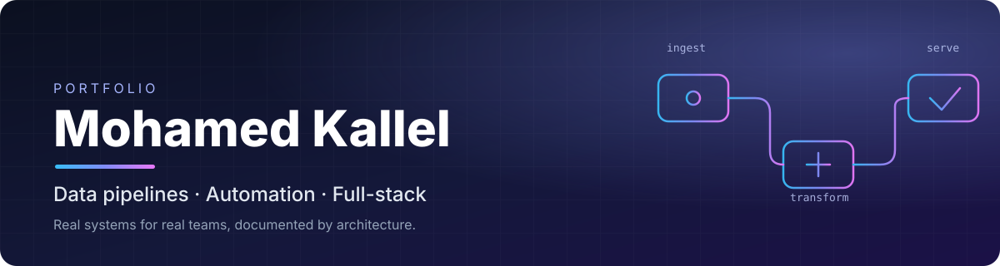

<div align="center">



<br/>


**Engineering student building production data pipelines, internal tools and web apps.**
This repository is an architecture-first tour of that work.

[Projects](#-projects) · [Stack](#-stack) · [How I build](#-how-i-build) · [About this repo](#-about-this-repository)

</div>

---

## 👋 Hello

I'm **Mohamed Kallel**. I build the systems that sit between an API and a decision: ingestion, normalisation, dashboards, automation, and the interfaces that non-technical teams actually use every day.

Most of what's here ran in production for real organisations (a student-run NGO, a consulting group, a small business). The rest is academic work in distributed systems, data engineering, simulation and visualisation.

I'm open to a **PFE (end-of-studies) internship in AI, automation and data**.

---

## 🧭 Projects

### 🏢 Production systems

| | Project | What it is | Core stack |
|:-:|---|---|---|
| 📊 | [**LC Performance Dashboard**](projects/aiesec/lc-performance-dashboard) | Self-refreshing performance dashboard with a staged, resumable sync from two APIs and national benchmarking | Apps Script · GraphQL · REST · Sheets API |
| 🧰 | [**ICX Tools Suite**](projects/aiesec/icx-tools-suite) | 13 internal tools on one shared core and a nine-rule engineering standard | Apps Script · GraphQL · Node.js · clasp |
| 🧲 | [**IGT Offline Candidate Matching**](projects/aiesec/igt-offline-candidate-matching) | Governed candidate sheet fed by a signed webhook from a CV-parsing pipeline | Apps Script · Web App · HMAC |
| 🛍️ | [**Merch Reservation Shop**](projects/aiesec/merch-reservation-shop) | Zero-payment reservation shop with a separate admin portal and oversell-proof stock | React · Vite · Tailwind · Supabase |
| 🎯 | [**Talent Recruitment Platform**](projects/aiesec/talent-recruitment-platform) | End-to-end recruitment flow: sign-up, application, interview booking, decisions | Next.js · Supabase · RLS · Gmail SMTP |
| 🧠 | [**N-Dash: Executive Operations Dashboard**](projects/consulting/n-dash) | Gmail + Calendar + project-file intelligence with LLM triage, daily digests and a web dashboard | Apps Script · Groq LLM · Vercel · GitHub Actions |
| 🔁 | [**Dolibarr → Swiver Migration**](projects/finance/dolibarr-to-swiver) | Two-phase, audited ERP-to-invoicing migration over a REST API, with a reverse-engineered API guide | Python · REST |

### 🤖 AI & automation

| | Project | What it is | Core stack |
|:-:|---|---|---|
| ✉️ | [**PFE Outreach Automation**](projects/ai-automation/pfe-outreach-automation) | Sourced-contact discovery and review-first Gmail drafting that can never auto-send | Node.js · Gmail API · TSV state machine |
| 🛡️ | [**Trustini**](projects/ai-automation/trustini) | Concept for multimodal trust verification of online content | Product design · pitch |

### 🧪 Data engineering

| | Project | What it is | Core stack |
|:-:|---|---|---|
| ⚡ | [**Energy Fraud Detection Pipeline**](projects/data-engineering/energy-fraud-detection) | Streaming smart-meter pipeline: simulator → Kafka → Spark → HDFS → Hive → report | Kafka · Spark Streaming · HDFS · Hive · Docker |
| 🗄️ | [**IT Jobs Data Warehouse**](projects/data-engineering/it-jobs-data-warehouse) | Multi-source star-schema warehouse for IT job-market analysis | SSIS · SQL Server · BI |

### 🎓 Academic

| Project | Topic | Stack |
|---|---|---|
| [**Climate Story, Interactive D3**](projects/academic/climate-d3-storytelling) | Scrollytelling data visualisation of CO₂ and temperature anomalies | D3.js v7 · GeoJSON |
| [**Stochastic Network Simulation**](projects/academic/stochastic-network-simulation) | Poisson and exponential traffic generators built from first principles | Python · NumPy · Matplotlib |
| [**RMI Multiplayer Tic-Tac-Toe**](projects/academic/rmi-multiplayer-game) | Distributed game server with matchmaking, remote sessions and client callbacks | Java RMI |
| [**Student Management API**](projects/academic/student-management-api) | Layered REST service with OpenAPI docs and service tests | Spring Boot · JPA · Swagger |

---

## 🧱 Stack

| Layer | Tools I use |
|---|---|
| **Languages** | JavaScript (ES2020+), TypeScript, Python, Java, SQL, HiveQL |
| **Front end** | React 18/19, Next.js App Router, Vite, Tailwind CSS, D3.js |
| **Back end & data stores** | Supabase (Postgres, Auth, Realtime, RLS), MySQL, SQL Server, Google Sheets as an operational store, Vercel serverless |
| **Automation** | Google Apps Script (V8), `clasp`, time-driven triggers, `LockService`, webhooks |
| **APIs** | GraphQL, REST, Gmail / Calendar / Drive / Sheets APIs, OAuth 2 |
| **Data engineering** | Kafka, Spark Structured Streaming, HDFS, Hive, SSIS (star schemas) |
| **AI** | LLM classification and summarisation (Groq), deterministic fallbacks, prompt and guardrail design |
| **DevOps & quality** | Docker Compose, GitHub Actions, Vercel, Node test runners, idempotent migrations |

---

## ⚙️ How I build

The same ideas show up across projects. Each case study links them to concrete decisions.

| Principle | What it looks like in practice |
|---|---|
| **Non-technical users are the real users** | Spreadsheet tools open on a Welcome page and an Insights page, protect everything the script owns, and explain failures in one human sentence. |
| **Design for hard platform limits** | Staged, resumable pipelines that outlive Apps Script's 6-minute cap, with time budgets and saved cursors. |
| **Own your writes** | Column-ownership contracts: the script writes only the columns it owns and never a cell a person might be editing. |
| **Idempotent and re-runnable** | Schema enforcement, migrations and syncs that are safe to run twice, with dry-run and rehearsal modes. |
| **Security lives in the data layer** | Row-Level Security, `SECURITY DEFINER` functions, HMAC-signed webhooks, narrow OAuth scopes, secrets only in properties or env. |
| **Fail closed, degrade gracefully** | LLM calls never throw into a flow and always have a deterministic fallback. Outreach tooling is structurally unable to send mail. |
| **Observable by default** | Run logs, correlation IDs, health strips and typed error codes instead of silent failures. |
| **Test what can break money or trust** | Unit tests around date logic, finance parsing, digests and API handlers, run in CI. |

---

## 🔒 About this repository

This is a **documentation-only portfolio**. Every project here is described by its purpose, architecture, data flow, stack and the engineering decisions behind it, **but the source code is deliberately not published**.

Why: most of these systems encode the internal processes, rules and data of the organisations I built them for. Their business logic, data models, identifiers and credentials are not mine to publish. What *is* mine is how they were designed, and that's what these pages show.

Happy to walk through any of them in more depth in an interview.

```
assets/                     banner
projects/
├── aiesec/                 production tooling for a student NGO
├── consulting/             executive operations dashboard
├── finance/                ERP migration
├── ai-automation/          outreach automation and concepts
├── data-engineering/       streaming pipeline and data warehouse
└── academic/               university projects
```

<div align="center"><sub>Architecture diagrams are written in Mermaid and render natively on GitHub.</sub></div>
