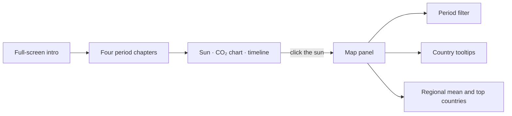

# 🌍 Climate Story: Interactive D3 Data Visualisation

> A scroll-driven, interactive story of rising CO₂ and global temperature. A living "sun" grows with the warming signal, and clicking it opens a country-by-country choropleth map filtered by historical period.

| | |
|---|---|
| **Context** | Data-visualisation course project |
| **Constraints** | D3.js v7, vanilla HTML/CSS/JS, no build tools, no frameworks |
| **Data** | CO₂ concentration, global temperature anomaly, per-country temperature anomalies (Our World in Data), country geometries (Natural Earth) |

---

## Design

| Layer | Choice | Why |
|---|---|---|
| **Narrative** | Scrollytelling in four chapters, from the early 1900s to the present | Chronology makes acceleration visible |
| **Metaphor** | An organic animated sun that grows and warms in colour | Immediate emotional read of "temperature rising" |
| **Evidence** | CO₂ time series with a filterable chart | Quantitative proof next to the metaphor |
| **Geography** | Choropleth map, period filter, regional means and hottest countries | Shows climate change is unevenly distributed |

## Engineering notes

- **Data join by ISO3 code** between CSV series and GeoJSON geometries; most countries receive values, and unmatched territories are handled gracefully.
- **`d3.geoNaturalEarth1()`** projection with a **Viridis** sequential scale, chosen for perceptual uniformity and colour-blind safety.
- **750 ms transitions** for period changes so the eye can follow the data.
- **Narration layer uses `pointer-events: none`** so the animated sun stays clickable underneath the text.
- **Responsive and accessible**: SVG `viewBox`, contrast-checked text, labelled controls, a close button with an ARIA label, and a mobile-friendly tap target.
- **Tested** in headless Chromium at desktop and mobile sizes with no console errors.
