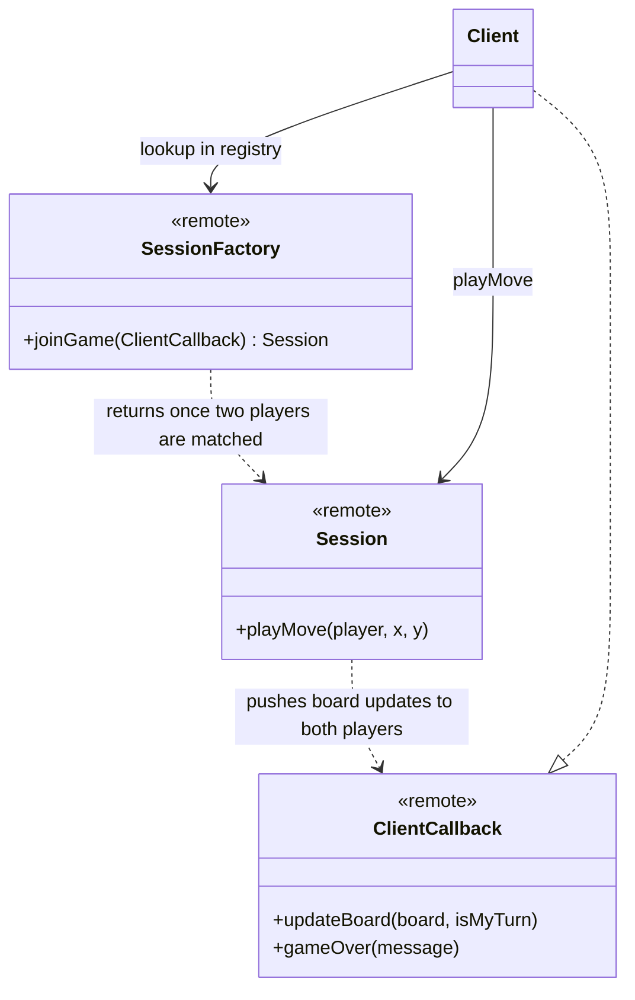
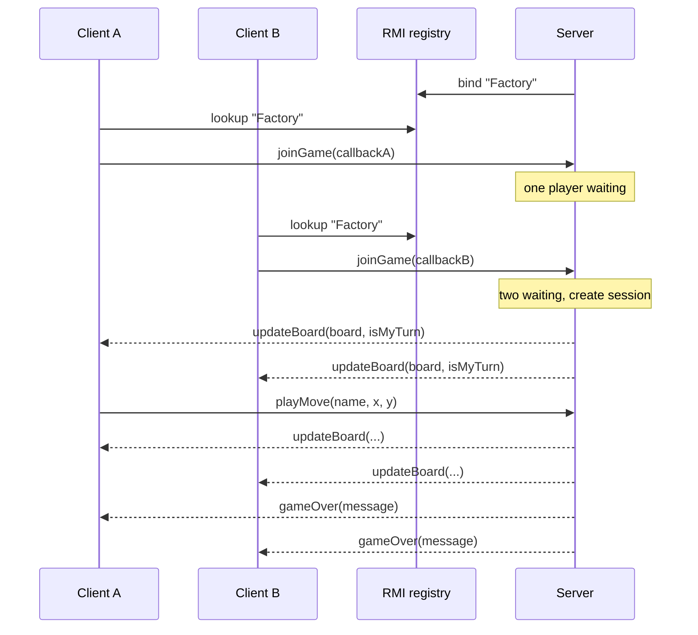

# 🎮 RMI Multiplayer Tic-Tac-Toe

> A distributed, two-player Tic-Tac-Toe on **Java RMI**. A server publishes a session factory in an RMI registry, clients queue to join, the server **matchmakes pairs of players** into a shared session, and every move is pushed back to both clients through callbacks.

| | |
|---|---|
| **Context** | Distributed systems and applications coursework |
| **Focus** | Remote objects, registry lookup, matchmaking, client callbacks, security policy |

---

## Architecture

## Highlights

- **Interfaces as contracts.** Every remote type is a `Remote` interface, and implementations are kept separate.
- **Factory plus registry.** Clients only need the registry address and the factory name.
- **Server-side matchmaking.** A synchronized join queue pairs players safely under concurrent connections.
- **Bidirectional communication.** Each client exports its own callback object, so the server pushes state instead of clients polling, and each side is told whether it's their turn.
- **Registry bootstrap** that creates the registry if missing or reuses a running one.
- **Security manager and policy file** configured as RMI requires.
