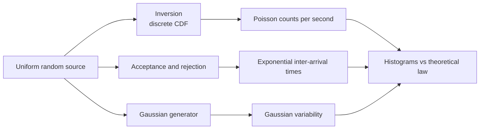

# 📈 Stochastic Network Simulation

> Network traffic simulated from first principles: random variates are generated with classical methods (inversion and rejection) rather than library samplers, then plotted to check them against the theory.

| | |
|---|---|
| **Context** | Stochastic processes coursework |
| **Focus** | Random-variate generation and simulation of a packet network |

---

## What it models

| Phenomenon | Distribution | Generation method |
|---|---|---|
| **Packets arriving per second** | Poisson | **Inversion** for discrete variables: build the cumulative distribution iteratively, draw a uniform and return the first index it falls below |
| **Time between two successive packets** | Exponential | **Acceptance–rejection**: propose from a simple distribution, accept with probability proportional to the target density |
| **Gaussian variability** | Normal | Generated from uniform variates |

## Why it's interesting

- Implements the algorithms **from the definition**, which shows what a library call hides.
- **Validates by simulation**: empirical histograms are compared with the theoretical densities.
- Provides the building blocks for a queueing or network-load model.
