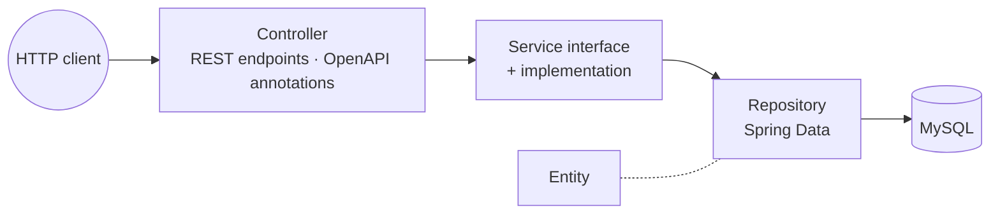

# 🎓 Student Management API

> A small, cleanly layered **Spring Boot REST service** for registering and listing students, with OpenAPI documentation and a service-layer test.

| | |
|---|---|
| **Context** | Enterprise Java / Spring coursework |
| **Focus** | Layered architecture, dependency injection, API documentation, testing |

---

## Architecture

| Layer | Responsibility |
|---|---|
| **Controller** | Exposes `register` and `list` endpoints, documented with OpenAPI annotations and CORS enabled |
| **Service** | A business interface and an implementation, so the controller depends on an abstraction |
| **Repository** | Spring Data JPA repository over MySQL |
| **Entity** | The student model |
| **Tests** | A service-implementation test |

## Highlights

- **Constructor injection** through Lombok, with no field injection.
- **Interface-driven services** keep layers swappable and testable.
- **Self-documenting API** via springdoc OpenAPI / Swagger UI.
