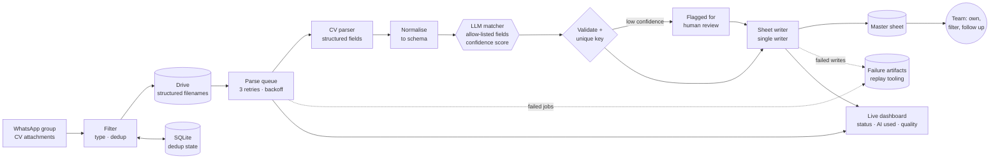

# 📥 CV Intake Agent

> A long-running agent that watches a **WhatsApp group** for CVs, stores them, **parses** them, uses an **LLM to match each candidate to the organisation's opportunity catalogue**, and writes one validated, deduplicated record per candidate into a governed Google Sheet. It runs as a supervised service with retries, replay tooling and a live dashboard.

| | |
|---|---|
| **Role** | Sole developer |
| **Users** | An exchange team that sources candidates over chat |
| **Source** | 🔒 Private (candidate data, opportunity catalogue and process rules) |

> **Why only the architecture is here.** The service handles candidates' personal data and encodes the organisation's opportunity catalogue and matching rules. None of that can be published, so this page documents the design, the agent boundaries and the safety decisions.

---

## The problem

Candidates sourced outside the main platform arrived as CV files in chat groups, with no owner, no status and no way to filter. Copying details by hand was slow and error-prone.

## Agent design

| Concept | In this system |
|---|---|
| **Goal** | Every CV that arrives becomes exactly one correct, owned, matched candidate record |
| **Perception** | Inbound messages of one WhatsApp group; attachments filtered by allowed file types |
| **Reasoning** | A CV parser extracts structured fields; an **LLM (via OpenRouter)** proposes the opportunity match and match notes with a confidence score |
| **Tools** | Drive upload and download, the CV parsing API, the LLM, and one write tool: the sheet writer |
| **Memory and state** | A SQLite database of processed messages and uploaded files, plus a job queue and per-CV artifacts (raw parse, normalised parse, failures) |
| **Autonomy level** | Acts alone from file to record. Low-confidence matches are flagged for human review rather than silently accepted. Humans own and follow up candidates afterwards |
| **Safety layer** | The LLM may only fill an allow-listed set of fields, with a timeout and one bounded retry. Everything it returns is validated before any write |

## Write path: from workflow tool to a single writer

The sheet write path was redesigned in three modes behind one setting, which let the change be proven before it went live:

| Mode | Behaviour |
|---|---|
| `webhook` | The service sends a signed request to an Apps Script endpoint that validates and upserts (see [IGT Offline Candidate Matching](../../aiesec/igt-offline-candidate-matching)) |
| `shadow` | Webhook write plus a direct dry-run comparison, to prove the new path produces identical results |
| `direct` | The service is the single writer through the Sheets API, with header-driven column mapping and a unique-key upsert; Apps Script keeps only the UI layer |

## Technology lineage

The first version of the intake pipeline was an **n8n** workflow. It was replaced by a purpose-built **Node.js** service for reliability (persistent dedup, retry queue, session handling for a long-lived WhatsApp client) and then simplified to a single sheet writer.

This service uses no agent framework. It implements the same patterns I used in earlier LangChain / LangGraph work in Python (explicit state, bounded tools, validated outputs) directly in Node.js.

## Reliability decisions

- **Non-blocking pipeline.** Parsing runs in a background queue so the chat listener is never blocked. Concurrency is 1 on purpose for a 1 GB host.
- **Retries with backoff**, then persisted **failure artifacts** and **replay scripts** for failed parses and failed sheet writes.
- **Idempotent by key.** A deterministic unique key means a returning candidate is updated, not duplicated. Matching notes merge instead of overwriting human-reviewed ones.
- **Self-healing session.** The WhatsApp client recovers from disconnects and takes over cleanly after a process restart.
- **Observable.** Structured logs, a heartbeat with queue depth, and a dashboard showing who sent each CV, where it is stored, parse status, whether the LLM was used and a quality score.
- **Safe defaults.** The dashboard binds to localhost unless explicitly exposed behind a reverse proxy.

## What I'd highlight in an interview

1. **An agent with one write tool**, and a validated, idempotent boundary around it.
2. **Bounded LLM use:** allow-listed fields, a confidence threshold, a timeout and a human-review path.
3. **Safe migration of the write path** (webhook → shadow → direct) instead of a big-bang switch.
4. **From n8n to owned code**, and why.
