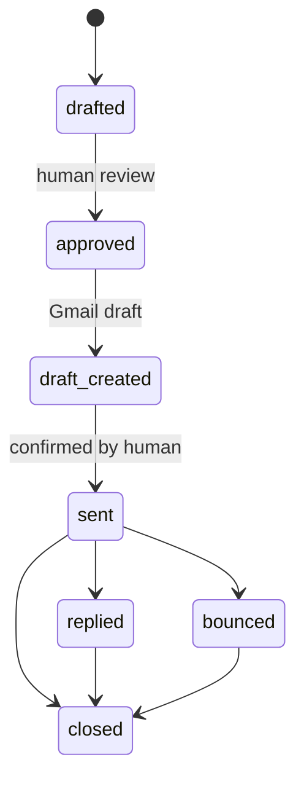
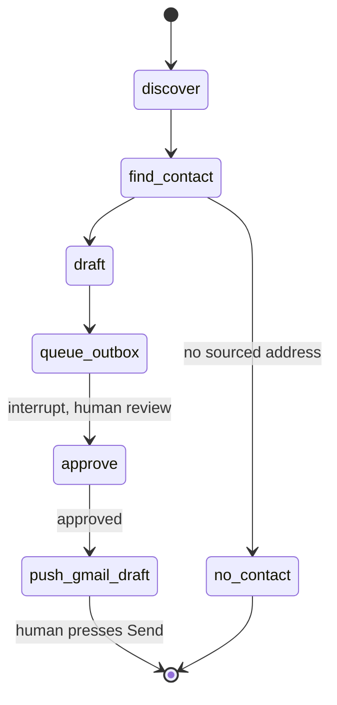

# ✉️ PFE Outreach Agent

> A **human-supervised, tool-using agent** for **spontaneous internship applications**: it discovers small companies with a plausible project, finds a *publicly sourced* contact, drafts a targeted email, queues it for human approval and pushes it to **Gmail drafts**. It is designed so that it **cannot send mail**.

> **Why only the architecture is here.** The working system holds personal data, contact lists and application templates, so the source stays private. This page documents the agent design and its guardrails.

| | |
|---|---|
| **Built on** | An open-source AI job-search framework (career-ops). I extended it with a new application channel. |
| **My contribution** | The spontaneous-application channel: design spec, modules, Gmail integration, board integration, tests |
| **Source** | 🔒 Private (personal data, contact lists and templates) |

---

## The problem

Advertised internship roles are a small fraction of the market. Small companies and labs rarely post, but cold-emailing at scale is spammy and risky: guessed addresses, generic text and accidental mass-sends damage both the sender and the recipient.

## The design

A spec-first design with **five single-purpose units**, each with a file-based interface so it can be tested alone.

```mermaid
flowchart LR
    CFG["Config<br/>sectors · seeds · quotas"] --> DISC
    DISC["1 · Discovery<br/>public registries and project signals"] --> CAND[("candidates.jsonl")]
    CAND --> CON["2 · Contact finder<br/>public pages of the company's own domain"]
    CON --> DRAFT["3 · Draft step<br/>language and CV chosen per target"]
    DRAFT --> OUT[("4 · Outbox<br/>TSV state machine")]
    OUT --> BOARD["Review board<br/>human approves"]
    BOARD -->|approved| GM["5 · Gmail draft pusher<br/>drafts.create only"]
    GM --> D(("Gmail Drafts"))
    D -->|"human presses Send"| SENT["Sent · tracked on board"]
```

### State machine

## Agent design

| Concept | In this system |
|---|---|
| **Goal** | Turn a sector and a quota into reviewed, sourced, personalised application drafts |
| **Tools** | Public registry and web lookup, contact extraction from a company's own domain, template and CV selection, Gmail `drafts.create` |
| **State and memory** | An append-only candidates file and a TSV outbox that acts as an explicit state machine; every row stores the evidence (source URL, language rule, cited project signal) |
| **Planning** | Config-driven: sectors, seeds and daily quotas decide what the agent works on next |
| **Autonomy level** | Acts alone up to *draft*; a human is the only path to *approved* and *sent* |
| **Safety layer** | Structural guardrails (below), enforced in code and by tests rather than by prompt wording |

Each of the five units is a single-purpose agent step with a file-based interface, so it can be run, tested and replaced on its own. That is what makes the pipeline auditable.

## LangGraph view of this agent

The runtime is Node.js with a TSV outbox, but the control flow is a graph, and this is how it maps onto **LangGraph** concepts. It is a design reference, not the code that runs.

| LangGraph concept | In this agent |
|---|---|
| **State** | One outbox row per company: domain, evidence URL, contact and confidence, language rule, draft, status |
| **Nodes** | `discover` → `find_contact` → `draft` → `queue_outbox` → `approve` → `push_gmail_draft` |
| **Conditional edges** | No sourced contact → end as "no contact". Duplicate domain → end. Daily cap reached → pause. Negative reply → close the domain permanently |
| **Human-in-the-loop** | `approve` is an interrupt before the only action with side effects. A person approves, then a person presses Send in Gmail |
| **Checkpointing** | The TSV outbox is the persisted state, so the run resumes from any row |
| **Tools** | Registry and web lookup, contact extraction, template selection and Gmail `drafts.create` only |

## Technology lineage

Built as an extension of an open-source AI job-search framework (career-ops): I added a new application channel with a design spec, five modules, Gmail integration, board integration and tests, without breaking the host project.

## Guardrails (the interesting part)

- **Sourced contacts only.** An address must come with the URL where it was found. No guessing. A pattern-derived address is allowed only when another public address on the same domain confirms the pattern, and is then marked low confidence.
- **No contact, no email.** A company without a sourced address stays on the board as "no contact" and is never queued.
- **Cannot send, by construction.** The Gmail scope technically allows sending, so the guarantee is enforced in code: only the draft-creation endpoint is ever called, and a **source-grep test fails the build** if any Gmail module references a send endpoint.
- **Throttled.** A daily cap on drafts and a gentler first-week pilot protect the sender's reputation.
- **One email per company, ever.** Duplicate domains are refused and negative replies close the domain permanently.
- **Page text is data, not instructions.** Fetched web content is treated as untrusted input, which defends against prompt injection from scraped pages.
- **No invented claims.** Email content is composed only from the applicant's own verified documents, plus one company-specific sentence tied to a cited project signal.
- **Deterministic language rule.** The email and CV language are chosen by a documented rule and the reason is stored on the row so it's checkable on the board.

## Integration

The outbox is the single source of truth; a "Spontaneous" tab on the existing job-tracking board reads it with stable hashed row IDs that cannot collide with scraped roles, and board statuses map onto the outbox states.

## What I'd highlight in an interview

1. **Designing for safe automation**: guardrails that are structural, not promises.
2. Extending a large open-source codebase respectfully, with a spec, tests and no breaking changes.
3. Prompt-injection awareness in agentic pipelines.
