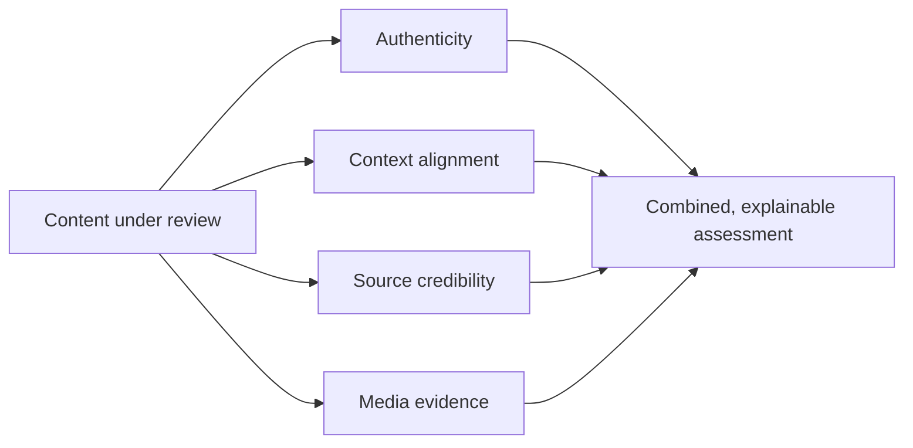

# 🛡️ Trustini

> A concept for a **multimodal trust-verification platform** that analyses online content for authenticity, context alignment, source credibility and media evidence.

| | |
|---|---|
| **Type** | Product concept with presentation material |
| **What's public** | This page (the concept is described, not the implementation) |

---

## The idea

Misleading content rarely fails on a single axis. A genuine image can carry a false caption, a credible source can repost old material, a fake can look flawless. Trustini looks at content through **four complementary lenses** rather than one score.

| Lens | Question it answers |
|---|---|
| **Content authenticity** | Is the media genuine, or altered or generated? |
| **Context alignment** | Does the media actually match what is being claimed about it? |
| **Source credibility** | How reliable is the origin that published it? |
| **Media evidence** | What corroborating or contradicting evidence exists elsewhere? |

## Conceptual flow

