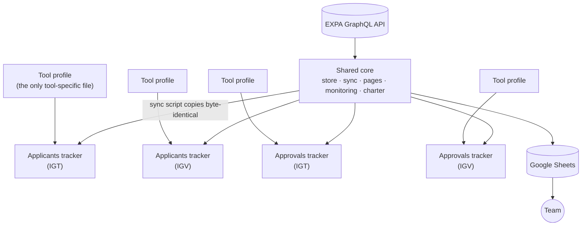

# 🧰 ICX Tools Suite

> A family of 13 internal tools for an incoming-exchange team: applicant trackers, approval trackers, contacts directories, opportunity search and contract automation. They were rebuilt on **one shared core** under a written nine-rule engineering standard.

| | |
|---|---|
| **Role** | Developer and maintainer; drove the tools reform and its engineering standard |
| **Users** | Non-technical team members working in Google Sheets |
| **Tools** | 12 Apps Script tools plus 1 Node.js service |
| **Source** | 🔒 Private (operational data, internal rules and personal data) |

---

## The problem

Over time each tool had grown on its own: one tool was a single ~200 KB file, each had different menus, "clear and rewrite" syncs that fought with people editing the sheet, and no consistent way to know whether a sync had worked. Non-technical users could not trust or navigate them.

## Technology lineage

The tools began as **n8n** workflows and were re-implemented as **Google Apps Script** on a shared core, so the team no longer depends on an external orchestrator. Most of the suite is deterministic sync and reporting; its agent-like pieces are the scheduled, self-auditing sync loops (watermark sync, trigger audit, confidence-scored directory matching that leaves unmatched rows blank rather than guessing) and the CV intake service, documented as the [CV Intake Agent](../../ai-automation/cv-intake-agent). The source stays private because it encodes operational data, internal rules and personal data.

## The reform

I defined an **engineering standard (R1–R9)** and rebuilt the tools on a **shared core**, so every tool behaves the same way and a fix lands everywhere.

A tool is a **profile** (columns, filters, dashboard kind) on top of the core. The core is edited in one place and distributed to every tool by a sync script.

## The standard, in short

| Rule | Idea |
|---|---|
| **Welcome, then Insights** | Every tool opens on a Welcome page (links to every tab, contacts, guidelines) and an Insights dashboard that answers real questions: counts, averages, top lists, backlog age, workload by owner. |
| **Formulas first** | Insight numbers are live sheet formulas (`COUNTIFS`, `AVERAGEIFS`, `QUERY`, `FILTER`), so they're always fresh and cost zero script writes. Empty data renders cleanly, never `#DIV/0!`. |
| **Read-only by default, with column ownership** | Each column has exactly one owner: the **API**, a **human**, a **seed** (written once at creation) or a **formula**. The script only writes the cells it owns and never spans a human column. |
| **Header-based contracts** | Columns are located by header through a contract, never by index. A mismatch aborts with a typed error that lists expected versus found. Nothing is written into shifted columns. |
| **Charter and branding** | One visual charter for banners, contact cards, palette and chart colours. |
| **Monitoring** | A hidden run log and event log feed a health strip on the Insights page: last successful update, outcome, rows added or updated, and a one-line hint on failure with no personal data or stack traces. |
| **In-cell controls** | Filters and views are driven from cells on the page, not from dialogs. |

## Engineering highlights

- **Watermark-based incremental sync.** Hourly syncs fetch only what changed. A nightly pass refreshes everything. Daily reminders are emailed to owners from a team tab.
- **Safe migrations with rehearsal.** Moving a live tool onto the core runs as *plan → rehearsal on a copy → migrate*, with a backup copy, protection removal, type verification of every migrated cell, and a requirement that the second sync writes nothing (proving idempotency). The migration refuses to run twice.
- **Rollback by design.** The old code is snapshotted as a versioned Apps Script release before any large push.
- **Privacy by removal.** A document-handling module that stored sensitive scans was deleted on purpose when the process changed, and the legacy state it left behind is cleaned up by the migration.
- **Typed error codes** (for example a header-mismatch code) make failures diagnosable by a non-developer.

## Tool families

| Family | What it does |
|---|---|
| **Applicant trackers** | Incoming applications with Welcome, Insights and Month View, watermark sync and daily reminders |
| **Approval trackers** | Approved participants through "to be realized → realized → finished", with action tiles, arrivals calendar and workload per owner |
| **Directories** | Contact directories per country and committee, with confidence-scored role matching (no guessing: unmatched stays blank with an explanation) |
| **Opportunity search** | Scheduled backend sync of opportunities into tabs, with an audit trigger that recreates missing triggers and a self-limiting retry |
| **Contract tools** | Drive folder automation and a contracts register |
| **Offline matching** | Governed sheet with a webhook-fed CV pipeline (see [IGT Offline Candidate Matching](../igt-offline-candidate-matching)) |
| **CV intake service** | Node.js: group-chat CVs → Drive → parsing → Google Sheet |

## What I'd highlight in an interview

1. Turning ad-hoc scripts into a **platform**: a shared core, a profile per tool and a written standard.
2. **Zero-downtime migration** discipline for tools that people are using live.
3. Designing for people who never open the script editor.
