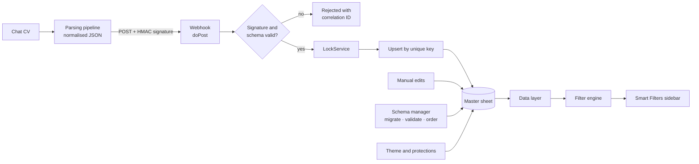

# 🧲 IGT Offline Candidate Matching

> A governed Google Sheet for matching candidates who are sourced **offline** (for example CVs arriving over WhatsApp), with a **signed webhook** that lets an automated CV-parsing pipeline write candidates straight into it.

| | |
|---|---|
| **Role** | Sole developer |
| **Scale** | ~3,700 lines, 8 modules, zero dependencies |
| **Users** | Exchange team members who own, filter and follow up candidates |
| **Source** | 🔒 Private (candidate schema and process rules; personal data) |

---

## The problem

Candidates sourced outside the main platform had no home. Their details lived in chat groups and loose files, with no ownership, no status and no way to filter. A separate automated pipeline already extracted structured data from the CVs, but had nowhere safe to put it.

## The solution

One governed sheet with a fixed schema, ownership and status tracking, **plus** an authenticated HTTP endpoint so the pipeline can insert and update candidates without a human copying anything.

## Where it sits: the agent's tool boundary

This is the **action layer** of a CV-intake agent (see [CV Intake Agent](../../ai-automation/cv-intake-agent)). The agent perceives CVs sent over chat, parses them and uses an LLM to match each candidate to an opportunity; this sheet and its webhook are the one *tool* it writes through (the service can also write directly through the Sheets API, with the webhook kept as an alternative mode). Keeping that boundary signed, validated and idempotent is what makes an LLM-driven writer safe to attach to a shared sheet.

**Technology lineage.** The sheet's ingestion started as an **n8n** workflow and was re-implemented as **Google Apps Script** (HtmlService sidebar, web-app webhook, `LockService`), removing the external orchestrator from the critical path. The source stays private because it encodes the candidate schema, process rules and personal data.

## Architecture

## Engineering highlights

- **Authenticated ingestion.** Requests carry an HMAC-SHA256 signature over the body, verified against a shared secret held in Script Properties. Unsigned or tampered requests are rejected.
- **Atomic, idempotent writes.** A `LockService` lock wraps writes so concurrent requests can't interleave or leave half-written rows. A deterministic unique key means a returning candidate is *updated*, not duplicated.
- **Batch or single payloads**, validated against a normalised schema before anything touches the sheet.
- **Traceable.** Every request gets a correlation ID that appears in all log lines, plus built-in self-test and diagnose helpers reachable from the menu.
- **Self-healing schema.** A schema manager migrates legacy column names, inserts missing columns, re-applies validation and enforces column order. It runs on every open and is safe to repeat. All lookups go by **header name**, so moving a column can't corrupt a write.
- **Smart Filters sidebar.** A custom HTML sidebar filters on owners, status, provider, origin and presence of CV or notes, with free-text search. The last filter state persists per user.
- **Clean retirement.** Obsolete flows were disabled with explicit "deprecated" errors instead of silent removal.

## Module map

| Area | Responsibility |
|---|---|
| Config | Single source of truth for schema, groups, dropdowns, colours and header lookup |
| Entry | Menu, open handler, sidebar handlers |
| Schema | Header map, migrations, validation, order |
| Sheet | Theme, formatting, conditional formatting, protections |
| Data and filters | Record reads and pure filtering logic |
| UI | Sidebar |
| Webhook | Endpoint, signature check, atomic ingestion |

## What I'd highlight in an interview

1. A small, **secure integration surface** (HMAC, locking, idempotency) in a platform that has no native auth for webhooks.
2. Making a spreadsheet resilient to its own users: header-based access and self-healing structure.
