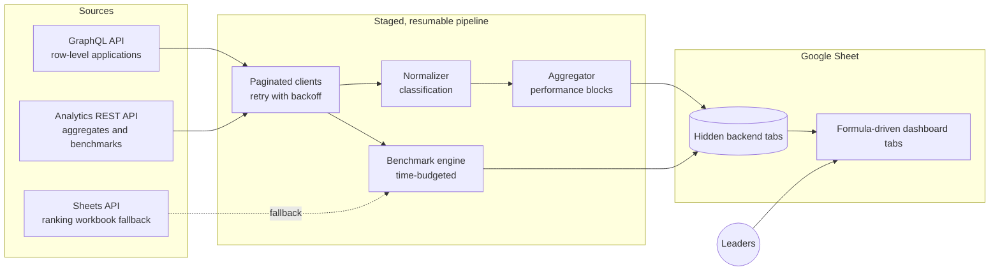
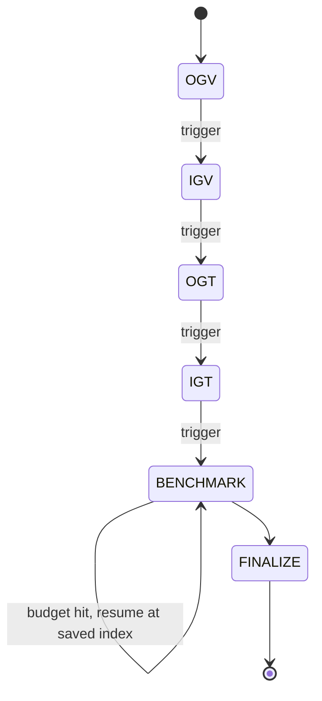

# 📊 LC Performance Dashboard

> A self-refreshing performance dashboard for a Local Committee of a student NGO, with national benchmarking against every other committee. Built entirely on Google Apps Script, with no servers and no build step.

| | |
|---|---|
| **Role** | Sole developer: design, build, refactor, hardening |
| **Scale** | ~9,300 lines across 30+ modules, no dependencies |
| **Users** | Committee leaders and members, reading a Google Sheet |
| **Source** | 🔒 Private (encodes the organisation's performance rules and data model) |

---

## The problem

Leaders needed one trustworthy view of committee performance: this term against last term, growth by product, and how they stack up nationally. The data lived behind two different APIs, and the figures were being assembled by hand in spreadsheets.

## The solution

A Google Sheet that refreshes itself. Row-level data comes from a **GraphQL** API, aggregate and benchmark figures from a **REST analytics** API. A normalisation layer reconciles them, and the visible dashboard tabs are driven by live formulas over hidden backend tabs, so the presentation never needs scripting.

## Architecture

### Staged sync with continuation triggers

A full refresh is longer than Apps Script's 6-minute execution limit, so it is split into stages. Each stage finishes, saves its state and schedules the next through a one-shot time-based trigger.

## Engineering highlights

- **Resumable by design.** Job state lives in Script Properties. If a stage is interrupted it resumes where it stopped instead of restarting.
- **Time-budgeted benchmarking.** The benchmark stage makes several API calls per committee, stops at a safe time budget, stores partial rows and continues from the saved index on the next trigger.
- **Fail loudly on policy drift.** Reporting periods are pinned. If configuration drifts from policy, the script throws rather than silently reporting the wrong period.
- **API-first with a fallback path.** Benchmarking prefers the analytics API and falls back to a ranking workbook read through the Sheets API.
- **Retry with exponential backoff** for transient failures, while application-level GraphQL errors fail immediately (they are not retryable).
- **Safe public sharing.** The dashboard can be shared widely: a protection module locks everything except a whitelist of filter cells, installs an edit-guard trigger and resets filters to defaults daily.
- **Self-documenting workbook.** A manager module audits every sheet and writes a living catalogue of what each tab is for, its edit policy, what feeds it and what consumes it.
- **Hardening pass.** A dedicated refactor removed a hard-coded key, moved auth out of URLs, fixed ghost menu items and split a 3,900-line orchestrator into focused modules.

## Module map

| Area | Responsibility |
|---|---|
| Orchestration | Menu, continuation triggers, job state, stage runners |
| API clients | Paginated GraphQL client, analytics REST client, config |
| Data layer | Normalisation, classification, aggregation, batched sheet writes |
| Benchmarking | National benchmark dataset and budgeted analytics loop |
| Presentation | Formula binding to the dashboard tabs |
| Protection | Range protections, edit guard, scheduled dropdown reset |
| Governance | Sheet catalogue, audit, cleanup of unused tabs |

## What I'd highlight in an interview

1. Working *with* a 6-minute execution ceiling instead of around it.
2. Splitting a monolith safely, keeping behaviour identical.
3. Treating a spreadsheet as a product: protections, audits and documentation.
