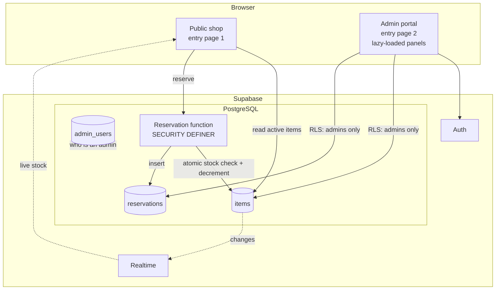

# 🛍️ Merch Reservation Shop

> A zero-payment merchandise shop for a student organisation. Members browse and reserve with no account; admins manage stock and reservations in a separate portal. Runs entirely on free tiers.

| | |
|---|---|
| **Role** | Sole developer: UI, database design, security model, deployment |
| **Cost to run** | Free tiers only |
| **Source** | 🔒 Private (organisation branding and the reservation rules) |

---

## Product

| Public shop | Admin portal |
|---|---|
| Catalogue by category with a single spotlight item, product carousel and **live stock** | Email and password login, restricted to users on an allow-list table |
| Reservation form with validation for variants and quantities. **No payment is taken.** | Item management: create, edit, stock, visibility, spotlight |
| Items update live via realtime subscriptions | Reservation management: filter and move through `pending → collected / cancelled` |

## Architecture

## Design decisions

- **Two entry points, not one app.** Public and admin are separate Vite pages, so visitors never download admin code. Admin panels are lazy-loaded and vendor libraries are split into long-lived cache chunks.
- **Stock can't be oversold.** Reservations go through a database function that performs the check and decrement as **one atomic conditional update**, then inserts the reservation. Two people cannot claim the last unit. There is **no public insert policy** on reservations, so that function is the only way in.
- **Security lives in the database.** Row-Level Security lets the public read active items only. Writes, and all reads of reservations, are admin-only. The anonymous key shipped to the browser carries no privileges beyond what those policies allow.
- **Backward-compatible RPC versions.** The client tries the newest reservation function and falls back to older versions, so a front-end deploy can't break an older database.
- **Idempotent, guarded SQL.** The setup script is safe to re-run, migrates old data (category normalisation, variant backfill) and aborts if anything needs manual review.
- **One spotlight, enforced by the database.** A partial unique index plus a trigger guarantee at most one spotlight item, so the UI can never drift from the data.
- **Hosting-portable.** Config for Vercel (rewrites, caching, security headers) and for Apache.

## What I'd highlight in an interview

1. **Authorization as data**: RLS policies plus a `SECURITY DEFINER` function instead of a custom API server.
2. Concurrency correctness without locks in app code.
3. Shipping a real product on a zero budget.
