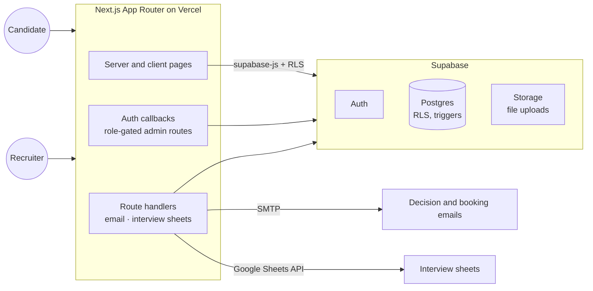
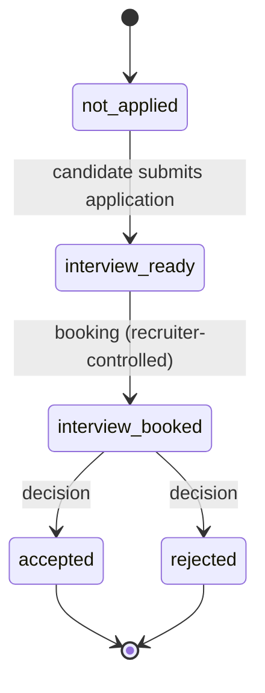

# 🎯 Talent Recruitment Platform

> A single authenticated flow that replaces scattered forms, chat threads and spreadsheets in a student organisation's recruitment: candidates sign up, apply, book an interview and receive a decision, while recruiters run the whole pipeline from one dashboard.

| | |
|---|---|
| **Role** | Developer |
| **Backend** | No custom server: the front end talks to Supabase directly, secured by Row-Level Security |
| **Hosting** | Free tiers (Vercel + Supabase) |
| **Source** | 🔒 Private (candidate data model and selection process) |

---

## The product

| Candidate side | Recruiter side |
|---|---|
| Sign-up, email confirmation, password reset, profile completion with avatar upload | Dashboard with candidate list, search, filters and export |
| Application form with file upload | **Kanban pipeline** across recruitment stages |
| Self-service **interview booking** through a tokenised link | Recruitment **waves**, interview slots and a live interview-day board |
| A dashboard that changes with the candidate's stage | Attendance flags and internal notes |
| Decision delivered by email | **Decisions** queue with admin-triggered emails |

## Architecture

### Candidate lifecycle

## Engineering highlights

- **Authorization in the database.** Row-Level Security and triggers enforce who can change what. A candidate may move *only* from "not applied" to "interview ready" on their own row (enforced by a narrowly scoped trigger exception); every other stage change is recruiter-only.
- **No custom API layer.** The browser uses `supabase-js` directly, so there's no extra server to secure or host. Route handlers exist only for side effects that need server secrets (email, Google APIs).
- **Admin-triggered communication.** Decision emails are an explicit action from a queue, not an automatic side effect, preventing accidental mass mailing.
- **Operational glue.** An interview can open a Google Sheet and sync its results back; interview-day boards auto-refresh for the people running the day.
- **Role-gated route groups** keep admin-only areas (waves, slots, decisions) separate from general recruiter pages.

## What I'd highlight in an interview

1. A **state machine enforced at the data layer**, not just in UI code.
2. Replacing five tools with one flow while staying on a zero-cost stack.
