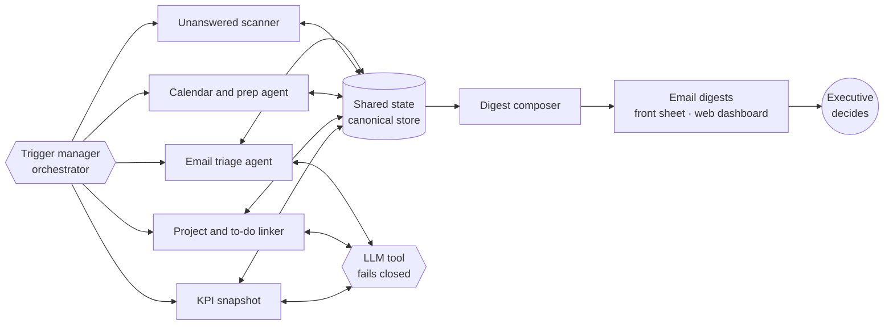
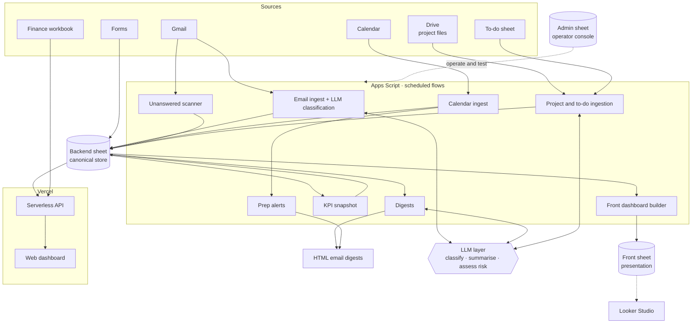

# 🧠 N-Dash: Executive Operations Agent

> A private engagement for a Tunisian consulting and training group. N-Dash is a **scheduled, multi-agent system** that answers one question every morning: **what does the executive need to decide, act on or watch today?** Specialist agents perceive Gmail, Calendar, project files and to-do lists, reason over them with an LLM (classify, summarise, assess risk, link), and act by publishing a triaged daily brief, an assistant digest and a live web dashboard.

> **Why only the architecture is here.** The system runs on a client's mailbox, calendar, finance and project data. None of that, nor the client's rules, can be published. This page documents the design, the agent boundaries and the engineering decisions, which are mine to share.

| | |
|---|---|
| **Role** | Engineer: migration, backend flows, LLM integration, web API, CI/CD, tests |
| **Client** | Private (name withheld) |
| **Users** | One executive and one assistant |
| **Source** | 🔒 Private (client's mailbox, calendar, finance and project data) |

---

## The problem

Information the executive needs was spread across an inbox, a calendar, per-project spreadsheets, a to-do sheet and a finance workbook. Nothing connected "this email" to "that project" or "that meeting", and nothing said which messages actually needed a decision.

## The solution

A scheduled backend (Apps Script) that ingests those sources into a canonical store, classifies and enriches them, and publishes three surfaces: **HTML email digests**, a rebuilt **front dashboard sheet** and a **web dashboard** on Vercel.

It began as an **n8n workflow** and was re-implemented as production Apps Script, preserving behaviour while removing the external orchestrator.

## Agent design

N-Dash is not one prompt behind a button. It is a set of narrow agents on a shared state store, each with its own tools, trigger and failure mode, coordinated by a single trigger manager that acts as the orchestrator.

| Agent (flow) | Perceives | Reasons (LLM) | Acts | Autonomy boundary |
|---|---|---|---|---|
| **Email triage** | New Gmail threads | Classifies: needs decision / action / watch / noise | Writes a typed, link-backed row to the store | Read-only mailbox scope |
| **Unanswered scanner** | Sent mail and replies | Detects threads awaiting an answer | Flags and ranks them | Never replies on anyone's behalf |
| **Calendar and prep** | Upcoming events | Decides which meetings need preparation | Sends prep alerts | Alerts the owner only |
| **Project and to-do linker** | Drive project files, to-do sheet | Links to-dos to projects, assesses risk | Writes links only above a confidence threshold | Low confidence stays unlinked |
| **KPI snapshot** | Store, finance workbook | Summarises trends | Writes snapshots | Read-only on finance |
| **Digest composer** | The whole store | Short executive insights | Sends HTML digests to two named recipients | Fixed recipients, no free-form sending |

**Human-in-the-loop by construction.** The agents never act on the world on the executive's behalf. They prepare decisions and the human makes them.

## Technology lineage

| Stage | What was used |
|---|---|
| **Orchestration, first version** | **n8n** workflows |
| **Production runtime** | Re-implemented as **Google Apps Script**, with a **Groq**-hosted model behind a single service wrapper, so the client has nothing external to host or maintain |
| **Agent framework experience** | Multi-agent patterns (tool use, routing, graph-style orchestration) come from my earlier LangChain / LangGraph work in Python; here the same ideas are implemented natively: a trigger manager as the orchestrator and a shared store as agent state |

Moving from a visual orchestrator to platform-native code was a deliberate trade: less expressive graph tooling, in exchange for zero infrastructure and a runtime the client's team can inspect.

## Evaluating and hardening the LLM layer

- **Strict structured output.** JSON tasks use enforced JSON schemas (enums, required keys, no extra keys) where the model supports it, with one retry in plain JSON mode if the schema is refused.
- **Prompt hardening with a written before/after report.** Prompts were rewritten with explicit rules, few-shot examples and anti-hallucination constraints (names, amounts and dates only if present in the source), and every change was documented.
- **Golden-set evaluation.** A fixed set of test cases is scored against a fake model in CI (shape, enums, lengths, language, banned phrases, invented names) and against the real model on demand.
- **Auditable.** Every LLM call is logged to an `AI_Logs` sheet, and each task has a rule-based fallback.

## Architecture

## Engineering highlights

- **Three-sheet architecture.** A *backend* sheet is the canonical store, a *front* sheet is rebuilt daily for presentation, and an *admin* sheet is a developer console. Identifiers are never hard-coded; they come from Script Properties.
- **Nine+ scheduled flows on one trigger manager.** A single bootstrap module creates, audits and deletes all managed triggers, so the schedule is code, not clicks.
- **LLM with guardrails.** Batch classification and short executive insights use a hosted LLM. The shared call wrapper **fails closed**: on any error it returns an empty result and never throws into a flow, and each use has a **deterministic fallback** (for example rule-based risk assessment) so the digest still ships.
- **Schema self-healing.** Header validation appends missing columns but never reorders, so a schema change deploys safely over live data.
- **Link-back everywhere.** Every row stores a source URL and an action URL, so any dashboard line opens the original email, event or file.
- **Narrow OAuth scopes.** Read-only Gmail and Calendar plus the minimum for sending digests and managing triggers.
- **Concurrency safe.** Each flow runs inside a lock with structured logs.
- **Cross-linking.** To-dos are linked to projects only above a confidence threshold, with the link table stored explicitly.
- **Web layer.** Serverless endpoints read the backend through the Sheets API and a finance workbook for executive KPIs, serving JSON to a static dashboard and a weekly view.

## Delivery & quality

| Concern | How |
|---|---|
| **CI** | GitHub Actions workflows for checks, plus separate verify and deploy pipelines for Apps Script and for Vercel |
| **Deploy safety** | Account and deploy guard scripts protect against pushing to the wrong target |
| **Tests** | A Node harness that stubs Apps Script services, with tests for calendar logic, digests, email briefs, finance parsing, project dates, strategic tabs and API handlers |
| **Docs** | Architecture, handover and performance-metrics documents, plus a written technical report |

## What I'd highlight in an interview

1. **Agent boundaries**: narrow agents with explicit tools, scopes and autonomy limits, not one open-ended agent.
2. **Replacing an orchestrator** (n8n, then a Python agent stack) with platform-native code without changing behaviour.
3. **Using an LLM responsibly** inside an agent: bounded, confidence-gated, link-backed, never on the critical path.
4. Building *testable* code on a platform that doesn't make that easy.
