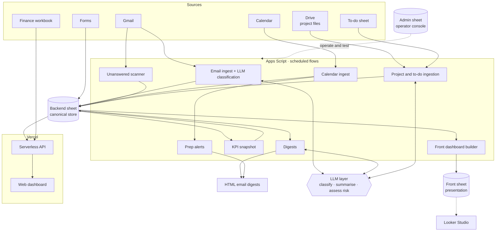

# 🧠 N-Dash: Executive Operations Dashboard

> A private engagement for a Tunisian consulting and training group. N-Dash answers one question every morning: **what does the executive need to decide, act on or watch today?** It turns Gmail, Calendar, project files and to-do lists into a triaged daily brief, an assistant digest and a live web dashboard.

| | |
|---|---|
| **Role** | Engineer: migration, backend flows, LLM integration, web API, CI/CD, tests |
| **Client** | Private (name withheld) |
| **Users** | One executive and one assistant |
| **Source** | 🔒 Private (client's mailbox, calendar, finance and project data) |

---

## The problem

Information the executive needs was spread across an inbox, a calendar, per-project spreadsheets, a to-do sheet and a finance workbook. Nothing connected "this email" to "that project" or "that meeting", and nothing said which messages actually needed a decision.

## The solution

A scheduled backend (Apps Script) that ingests those sources into a canonical store, classifies and enriches them, and publishes three surfaces: **HTML email digests**, a rebuilt **front dashboard sheet** and a **web dashboard** on Vercel.

It began as an **n8n workflow export** and was re-implemented as production Apps Script, preserving behaviour while removing the external orchestrator.

## Architecture

## Engineering highlights

- **Three-sheet architecture.** A *backend* sheet is the canonical store, a *front* sheet is rebuilt daily for presentation, and an *admin* sheet is a developer console. Identifiers are never hard-coded; they come from Script Properties.
- **Nine+ scheduled flows on one trigger manager.** A single bootstrap module creates, audits and deletes all managed triggers, so the schedule is code, not clicks.
- **LLM with guardrails.** Batch classification and short executive insights use a hosted LLM. The shared call wrapper **fails closed**: on any error it returns an empty result and never throws into a flow, and each use has a **deterministic fallback** (for example rule-based risk assessment) so the digest still ships.
- **Schema self-healing.** Header validation appends missing columns but never reorders, so a schema change deploys safely over live data.
- **Link-back everywhere.** Every row stores a source URL and an action URL, so any dashboard line opens the original email, event or file.
- **Narrow OAuth scopes.** Read-only Gmail and Calendar plus the minimum for sending digests and managing triggers.
- **Concurrency safe.** Each flow runs inside a lock with structured logs.
- **Cross-linking.** To-dos are linked to projects only above a confidence threshold, with the link table stored explicitly.
- **Web layer.** Serverless endpoints read the backend through the Sheets API and a finance workbook for executive KPIs, serving JSON to a static dashboard and a weekly view.

## Delivery & quality

| Concern | How |
|---|---|
| **CI** | GitHub Actions workflows for checks, plus separate verify and deploy pipelines for Apps Script and for Vercel |
| **Deploy safety** | Account and deploy guard scripts protect against pushing to the wrong target |
| **Tests** | A Node harness that stubs Apps Script services, with tests for calendar logic, digests, email briefs, finance parsing, project dates, strategic tabs and API handlers |
| **Docs** | Architecture, handover and performance-metrics documents, plus a written technical report |

## What I'd highlight in an interview

1. **Replacing an orchestrator** (n8n) with platform-native code without changing behaviour.
2. **Using an LLM responsibly** inside a pipeline: bounded, optional and never on the critical path.
3. Building *testable* code on a platform that doesn't make that easy.
