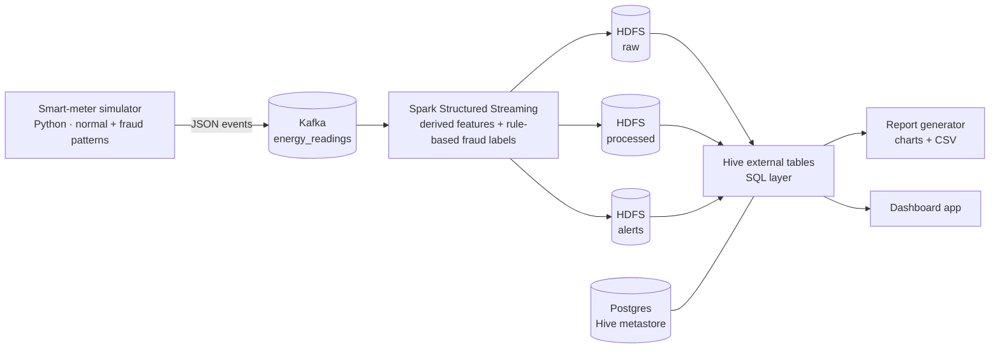

# ⚡ Energy Fraud Detection Pipeline

> An end-to-end **streaming analytics platform** that detects electricity fraud from smart-meter readings: a simulator emits events, Kafka transports them, Spark Structured Streaming enriches and flags them, HDFS stores them, Hive serves SQL, and a report is generated from the results. The whole stack runs from one `docker compose up`.

| | |
|---|---|
| **Context** | Cloud & Big Data course, 3-person team project |
| **Role** | Team member; my fork carries the orchestration and configuration fixes listed below (compose, Hadoop config, Hive image, Spark submit) |

---

## Architecture

## How it works

1. **Simulate.** One reading per meter at a fixed cadence, with injected suspicious behaviour: under-reporting, voltage spikes, odd-hour usage and bypass patterns.
2. **Stream.** Spark reads the Kafka topic, computes engineered features such as expected power and power ratio, and applies fraud rules.
3. **Store three views.** Raw readings, processed readings with features and labels, and an alerts-only dataset, all as Parquet in HDFS.
4. **Query.** Hive external tables sit on those datasets, so analysts can use plain SQL for fraud and consumption queries.
5. **Report.** A script queries Hive and renders charts and a summary CSV.

## Engineering highlights

- **Reliable orchestration.** Init containers (topic creation, HDFS directories) run once and exit cleanly, and services start in dependency order using **health checks**, which removed the startup race conditions of a naive compose file.
- **Correct Hadoop configuration** for a local cluster: fixed property names, edits directory and relaxed permissions for the test environment.
- **Hive metastore on Postgres** with the JDBC driver baked into a custom image.
- **Spark job submitted with the Kafka connector package** and HDFS config mounted in.
- **One-command startup** helpers for Windows and Linux/macOS.

## Concepts demonstrated

Event streaming · stream processing · lakehouse-style raw/processed/alert layering · schema-on-read with Hive · container orchestration.
