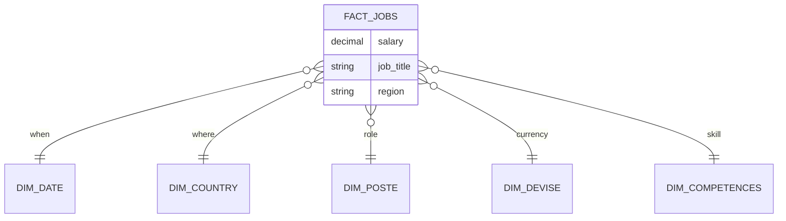
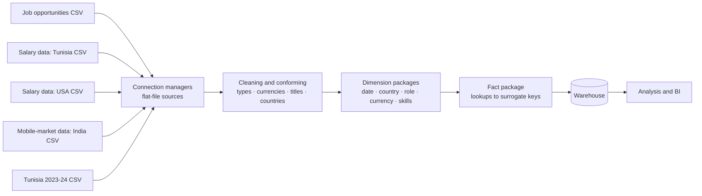

# 🗄️ IT Jobs Data Warehouse

> A multi-source **star-schema data warehouse** for analysing the IT job market: heterogeneous salary and job-opportunity datasets from different countries are cleaned, conformed and loaded through SSIS ETL packages into dimension and fact tables ready for BI.

| | |
|---|---|
| **Context** | Data warehousing coursework |
| **Role** | Designed the schema and built the ETL packages |

---

## Model

## ETL flow

## Highlights

- **One package per dimension plus a fact package**, sequenced by a control-flow package with SQL tasks and precedence constraints, so each step can be run and debugged alone.
- **Conformed dimensions** let salary data in different currencies and different countries be compared in the same model.
- **Reproducible**: connection managers and project parameters isolate environment details.
- **Cleaning at the boundary**: five unlike sources are normalised before they ever reach a dimension.

## Skills shown

Dimensional modelling · SSIS control flow and data flow · lookup-based fact loading · data conforming across sources.
