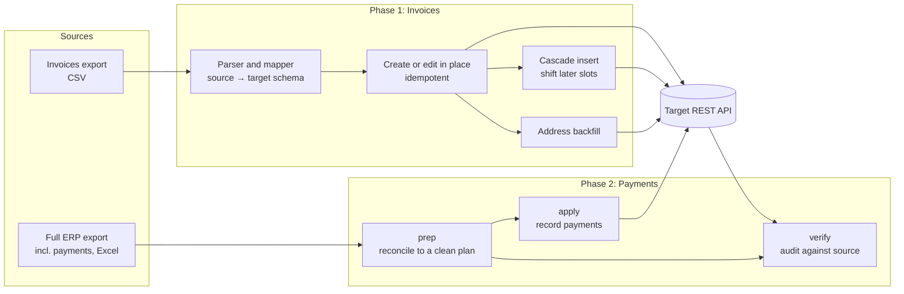

# 🔁 Dolibarr → Swiver Migration

> Moves a small business's invoices and payments from one ERP to another **purely through REST APIs**: no browser automation, no extension, no manual re-keying. Delivered in two audited phases, with a written guide to the target API's undocumented behaviour.

| | |
|---|---|
| **Role** | Sole developer |
| **Outcome** | Both phases completed and audited with **zero discrepancies** |
| **Source** | 🔒 Private (client financial data and credentials) |

---

## The problem

A business switching invoicing platforms needed its history of invoices, numbered sequentially and legally contiguous, to exist in the new system with the right customers, addresses, line designations and payment status. The new platform offered an API but no bulk import.

## The approach

Treat the migration as a **data pipeline with verification**, not a one-off script.

## Engineering highlights

- **Library plus scripts.** One core client and parser is reused by every step, so mapping rules live in exactly one place.
- **Idempotent writes.** Migration can edit an invoice in place or create a new one, so re-running never duplicates.
- **A solution for a hard constraint.** Sequential numbering had to stay contiguous when a missing record surfaced late. A *cascade insert* tool shifts later slots to make room while preserving order.
- **Prep → apply → verify** for payments: a reconciled plan is generated and reviewed *before* anything is written, then verified against the source after.
- **Read-only probe tools** explored the target API's payload shapes safely before any write path was built.
- **API reverse-engineering, documented.** The findings (field quirks, ordering rules, required payload variants) became a reference guide so the next migration starts from knowledge, not guesswork.
- **Secrets by environment only.** Credentials come from a local `.env`; only a template is ever committed.

## What I'd highlight in an interview

1. Verification-first migration thinking: plan, apply, audit.
2. Turning an undocumented API into a reusable guide.
