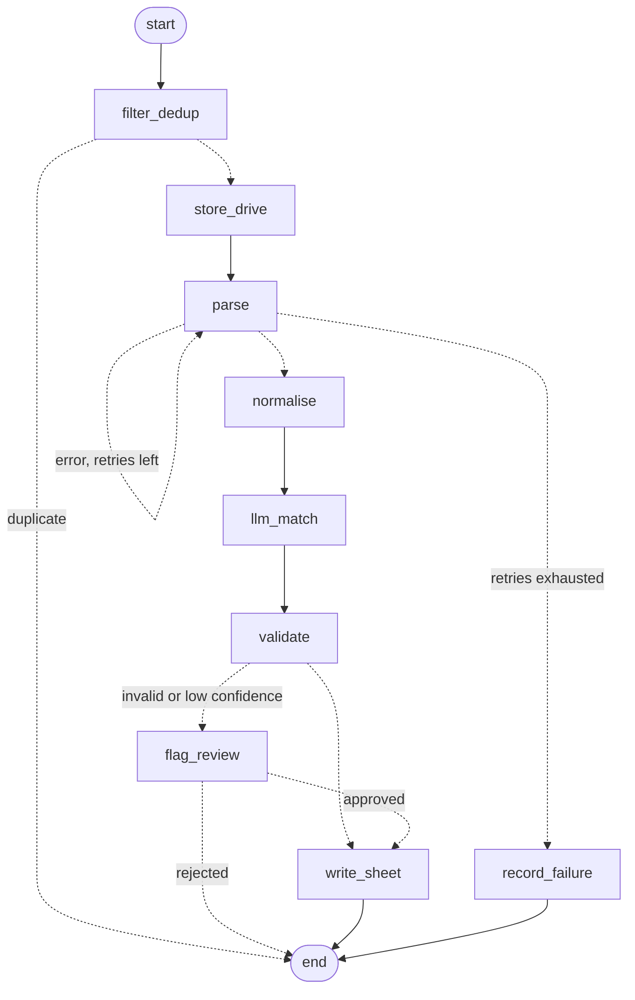

# CV Intake Agent: LangGraph prototype

A small, runnable **LangGraph** implementation of the control flow behind the [CV Intake Agent](../../projects/ai-automation/cv-intake-agent). It is a reference prototype: the production service is Node.js, and this version exists to show the same agent as an explicit state graph with retries, conditional routing, a human-in-the-loop interrupt and checkpointing.

**Everything here is synthetic.** There are no real CVs, no real catalogue and no credentials. The chat, Drive, parser, LLM and sheet are in-memory fakes, and the "LLM" is a deterministic keyword matcher, so the repo runs offline and the tests are repeatable. The point is the control flow around a model, not the model.

## The graph

This diagram is generated from the compiled graph (`graph.get_graph().draw_mermaid()`), so it matches the code.



| LangGraph feature | Where it is used |
|---|---|
| `StateGraph` with a typed state | `cv_agent/state.py`, one job per CV |
| Conditional edges | Dedup, parse retry loop, validation routing, review outcome |
| Cycle with a retry budget | `parse` loops back to itself up to `max_attempts` times |
| `interrupt()` and `Command(resume=...)` | `flag_review` pauses the run until a person decides |
| Checkpointer (`InMemorySaver`) | Makes the pause and resume possible; a durable saver would survive restarts |
| Reducer on `trace` | Every node appends its name, so a test can assert the exact path taken |

## Safety decisions

- **The model cannot write anything it wasn't allowed to.** The matcher's output is filtered to an allow-list of fields (`opportunity`, `confidence`, `notes`). A test makes the fake model return extra fields and checks they never reach the sheet.
- **Low confidence or invalid data never reaches the sheet silently.** It pauses for a human.
- **Idempotent writes.** The sheet is keyed on the lower-cased email, so the same candidate sent twice is updated, not duplicated.
- **Failures are recorded, not swallowed.** A CV that cannot be parsed after the retry budget ends in `record_failure`.

## Run it

```bash
python -m venv .venv
.venv/Scripts/activate        # on macOS/Linux: source .venv/bin/activate
pip install -r requirements.txt
python demo.py
pytest --cov=cv_agent
```

The demo feeds six synthetic CVs through the graph and shows each path: a clean write, a flaky parse that recovers on retry, a corrupt file that fails, a low-confidence match that pauses for review, a duplicate message, and a returning candidate that updates its row.

## Layout

```
cv_agent/
  state.py    typed graph state
  tools.py    in-memory fakes for chat, Drive, parser, LLM and sheet
  graph.py    nodes, conditional edges and the compiled graph
data/synthetic_cvs.json
demo.py
tests/test_graph.py   9 behavioural tests, 100% line coverage
```

## Limits

This prototype does not replace the production service. It has no real parser or model, an in-memory checkpointer, and no WhatsApp or Sheets integration. Swapping the fakes in `tools.py` for real clients is the intended extension point.
